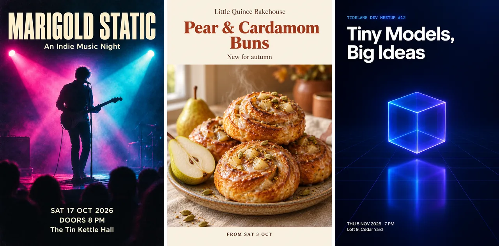

# AI Poster Maker Skill

[English](./README.md) | [简体中文](./README.zh-CN.md) | 日本語

> 👉 こちらもどうぞ [AI Logo Maker Skill](https://github.com/beatra-ai/ai-logo-maker-skill)

イベントの説明、商品写真、ブランドの参考素材から、視覚的な階層が明確で文字スペースを確保したイベントポスター、プロモバナー、SNS 画像を作成。Claude Code、Cursor、Codex、Windsurf、Cline、OpenClaw のどれからでもそのまま使えます。

> [!IMPORTANT]
> 生成には [Beatra](https://beatra.ai?utm_source=github&utm_medium=flagship&utm_campaign=ai-poster-maker-skill) アカウントが必要で、クレジットを消費します。スキル自体のインストールは無料です。

| 項目 | 内容 |
| --- | --- |
| **できること** | テーマの説明、商品写真、ブランド参照画像から、スクロールを止めるイベントポスター、プロモーションバナー、SNSグラフィックを作成。強い視覚階層、カテゴリー別スタイリング、テキストスペースを確保。 |
| **モデル** | Qwen Image 2.0 Fast、Qwen Image 3.0、Qwen Image 3.0 Pro、GPT Image 2.5 Flare、GPT Image 2.5 Sunburst、GPT Image 2、Wan Image 2.7 Fast、Qwen Image 2.0 Pro、Wan Image 2.7 Pro、MiniMax Image 01 Live、Wan 2.7、Wan 3.0 Video、MiniMax H3、Seedance 2.0 Mini、HappyHorse 1.1、Seedance 2.0 Fast、Seedance 2.0、Wan 3.0 Video Prime、Seedance 2.5 |
| **動作要件** | Python 3.10 以上と、`SKILL.md` を読み込めるエージェント |
| **費用** | インストールは無料。生成のたびに Beatra アカウントのクレジットを消費しますが、課金されるのは、その生成を明示的に依頼したとき、または確認カードを承認したときだけです。 |
| **対応エージェント** | Claude Code、Cursor、Codex、Windsurf、Cline、OpenClaw |

<p align="center"></p>

*短いブリーフから生成した 2:3 のポスター 3 枚：架空のインディーミュージックナイト Marigold Static、架空の Little Quince Bakehouse の季節限定パン発売、架空の Tidelane Dev Meetup のミニマルな開発者ミートアップ。Beatra AI で生成。*

| Skill | Entry point | Version |
| --- | --- | --- |
| [`poster-design-studio`](skills/poster-design-studio) | [SKILL.md](skills/poster-design-studio/SKILL.md) | 0.2.6 |

このリポジトリは [beatra-ai/beatra-skills](https://github.com/beatra-ai/beatra-skills/tree/main/skills/poster-design-studio) から自動的に公開されています。問題の報告はそちらへお願いします。

## インストール

[`skills`](https://skills.sh) CLI を使う場合：

```bash
npx skills add beatra-ai/ai-poster-maker-skill
```

Claude Code プラグインとして：

```bash
claude plugin marketplace add beatra-ai/ai-poster-maker-skill
claude plugin install poster-design-studio@ai-poster-maker-skill
```

Codex プラグインとして：

```bash
codex plugin marketplace add beatra-ai/ai-poster-maker-skill
codex plugin add poster-design-studio@ai-poster-maker-skill
```

GitHub Copilot CLI プラグインとして：

```bash
copilot plugin marketplace add beatra-ai/ai-poster-maker-skill
copilot plugin install poster-design-studio@ai-poster-maker-skill
```

Gemini CLI 拡張機能として：

```bash
gemini extensions install https://github.com/beatra-ai/ai-poster-maker-skill
```

GitHub CLI を使う場合：

```bash
gh skill install beatra-ai/ai-poster-maker-skill poster-design-studio
```

または、このリポジトリをクローンして `skills/poster-design-studio` を次の場所にコピーします：Claude Code は `~/.claude/skills/`、Cursor は `~/.cursor/skills/`、Codex は `~/.agents/skills/`、Windsurf は `~/.codeium/windsurf/skills/`、Cline は `~/.cline/skills/`、OpenClaw は `~/.openclaw/skills/`。

または、次の文をエージェントに貼り付けてください：

```text
https://github.com/beatra-ai/ai-poster-maker-skill から poster-design-studio スキル（フォルダ skills/poster-design-studio）をインストールし、その SKILL.md に従って私の Beatra アカウントに接続してください。
```

## 技術仕様と出力上限

2026-10-18 時点。最新の一覧：https://docs.beatra.ai/ja/docs/models

- **アップロード** — 1 ファイルあたり最大 100 MB。下記の各モデルの入力制限も適用されます
- **テキストから画像** — 10 モデル（Qwen Image 2.0 Fast、Qwen Image 3.0、Qwen Image 3.0 Pro、GPT Image 2.5 Flare、GPT Image 2.5 Sunburst、GPT Image 2、Wan Image 2.7 Fast、Qwen Image 2.0 Pro、Wan Image 2.7 Pro、MiniMax Image 01 Live）／PNG／1 リクエストあたり最大 4 枚／キャンバス最大 16.8 MP
  - 16.8 MP（4K ティア）：Wan Image 2.7 Pro（1 リクエストあたり最大 4 枚）／GPT Image 2.5 Flare、GPT Image 2.5 Sunburst、GPT Image 2（1 リクエストにつき 1 枚）
- **画像から画像** — 10 モデル（Qwen Image 2.0 Fast、Qwen Image 3.0、Qwen Image 3.0 Pro、Wan Image 2.7 Fast、Qwen Image 2.0 Pro、Wan Image 2.7 Pro、GPT Image 2.5 Flare、GPT Image 2.5 Sunburst、GPT Image 2、MiniMax Image 01 Live）／PNG／1 リクエストあたり最大 4 枚／キャンバス最大 16.8 MP
  - 16.8 MP（4K ティア）：GPT Image 2.5 Flare、GPT Image 2.5 Sunburst、GPT Image 2（1 リクエストにつき 1 枚）
  - 入力画像：1 リクエストあたり最大 4 枚、各 10〜20 MB／BMP、GIF、JPEG、PNG、TIFF、WEBP
- **画像編集** — 6 モデル（Qwen Image 2.0 Fast、Qwen Image 3.0、Qwen Image 3.0 Pro、Wan Image 2.7 Fast、Qwen Image 2.0 Pro、Wan Image 2.7 Pro）／PNG／1 リクエストあたり最大 4 枚／キャンバス最大 4.2 MP
  - 4.2 MP（2K ティア）：Qwen Image 2.0 Fast、Qwen Image 3.0、Qwen Image 3.0 Pro、Wan Image 2.7 Fast、Qwen Image 2.0 Pro、Wan Image 2.7 Pro（1 リクエストあたり最大 4 枚）
  - 入力画像：1 リクエストあたり最大 4 枚、各 10〜20 MB／BMP、GIF、JPEG、PNG、TIFF、WEBP
- **画像から動画** — 9 モデル（Wan 2.7、Wan 3.0 Video、MiniMax H3、Seedance 2.0 Mini、HappyHorse 1.1、Seedance 2.0 Fast、Seedance 2.0、Wan 3.0 Video Prime、Seedance 2.5）／480p〜4K／2〜30 秒／アスペクト比 16:9、1:1、21:9、3:4、4:3、9:16／MOV、MP4
  - 4K：Seedance 2.0、最長 15 秒
  - 30 秒：Wan 3.0 Video、Wan 3.0 Video Prime、Seedance 2.5、最高 1080p
  - ネイティブ音声：Wan 2.7、MiniMax H3

## 得られるもの

- **注目獲得のために設計** — 強い視覚階層が単一のフォーカルを中央に配置。クリーンなテキストスペースにより、大胆な見出しと詳細が画像と干渉せずに配置できます。
- **カテゴリー別スタイリング** — テックはクリーンで未来的、グルメは温かく食欲をそそる、音楽は鮮やかでエネルギッシュ、ファッションはエディトリアルで大胆。ポスターが被写体カテゴリーのビジュアル言語に合わせて調整されます。
- **あらゆるキャンバス、あらゆる用途** — Aシリーズ印刷チラシ、1:1 SNSスクエア、9:16ストーリー、16:9バナー、2:3 / 3:4スタンダードポスター。1つのブリーフで、印刷またはSNSに合ったキャンバスを選択。

## 活用シーン

- **イベント・音楽ポスター** — 鮮やかでエネルギッシュなイベント・音楽フェスポスター。大胆な見出しバンド、単一のパフォーマーやヒーローシーン、構造化された日付・会場ブロック付き。
- **映画・商品発表ポスター** — ドラマチックな照明とタイトルスペースのシネマティックな映画ポスターと、商品をセンターに据えたクリーンで未来的な商品発表ポスター。
- **セールチラシ・プロモーションバナー** — 温かく食欲をそそるセールチラシと高コントラストのプロモーションバナー。ヒーローオファーゾーン、商品サポート、明確なCTA付き。
- **SNSグラフィック** — プラットフォームネイティブな1:1、9:16、16:9のSNSグラフィック。単一のフォーカル、大きなテキストスペース、高コントラスト対応。

## よくある質問

### テーマの説明だけでポスターを作れますか？

はい。イベント、セール、映画、キャンペーンとスタイルの方向性を説明すると、その説明から完全なポスターが生成されます。選択したキャンバスとテキストスペース付き。

### 商品写真を発表ポスターに変えられますか？

はい。商品写真をアップロードすると、クリーンな背景、ブランドカラースタイリング、見出しと日付用のテキストスペースを備えた洗練された発表ポスターに変換されます。

### 見出しと詳細用のスペースはありますか？

はい。すべてのポスターにクリーンなテキストスペース（上部、中央、下部）が予約されており、見出し、日付、CTAを画像と干渉せずに追加できます。

### 承認済みポスターの特定のエリアを修正できますか？

はい。承認済みポスターをアップロードし、修正したい箇所（雑然したコーナー、色温度、見出しコントラスト）を指定すると、そのエリアだけが編集され、他の部分は変わりません。

## 更新とセキュリティ

2026 年 10 月のリリース以降、このスキルに自動更新機能はありません。インストールしたファイルだけを実行し、
自動的に置き換えることはありません。更新はインストールに使ったツール（`npx skills update poster-design-studio` または
`gh skill update poster-design-studio`）で行ってください。詳細はスキル内の `references/updates-and-security.md` を参照してください。

## ライセンス

[MIT-0](LICENSE)：商用を含め、自由に使用・改変・再配布できます。クレジット表記は不要です。ClawHub 上のこれらのスキルと同じ条件です。

## リンク

- ウェブサイト — https://beatra.ai?utm_source=github&utm_medium=flagship&utm_campaign=ai-poster-maker-skill
- ドキュメント — https://docs.beatra.ai?utm_source=github&utm_medium=flagship&utm_campaign=ai-poster-maker-skill
- コンソール — https://console.beatra.ai
- AI エージェント向け — https://beatra.ai/llms.txt （インデックス）· https://beatra.ai/llms-full.txt （全スキルを 1 ファイルに）
